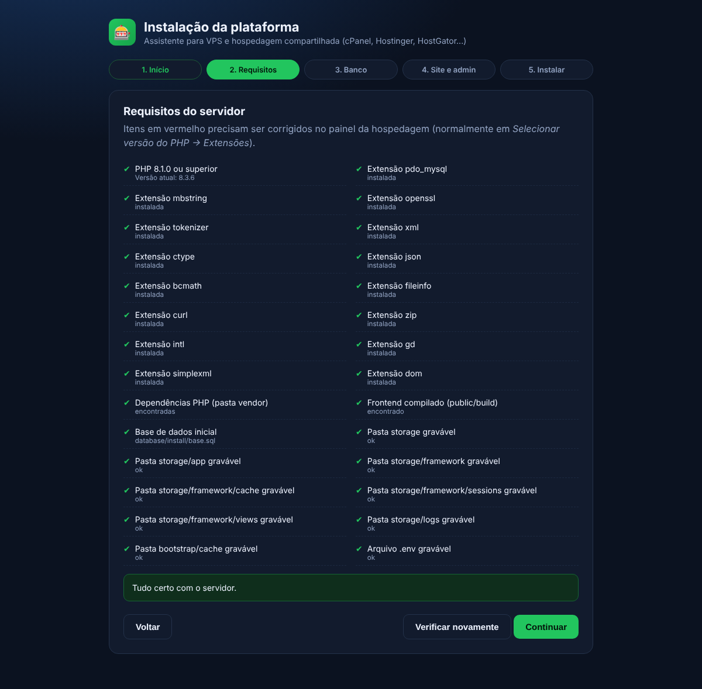
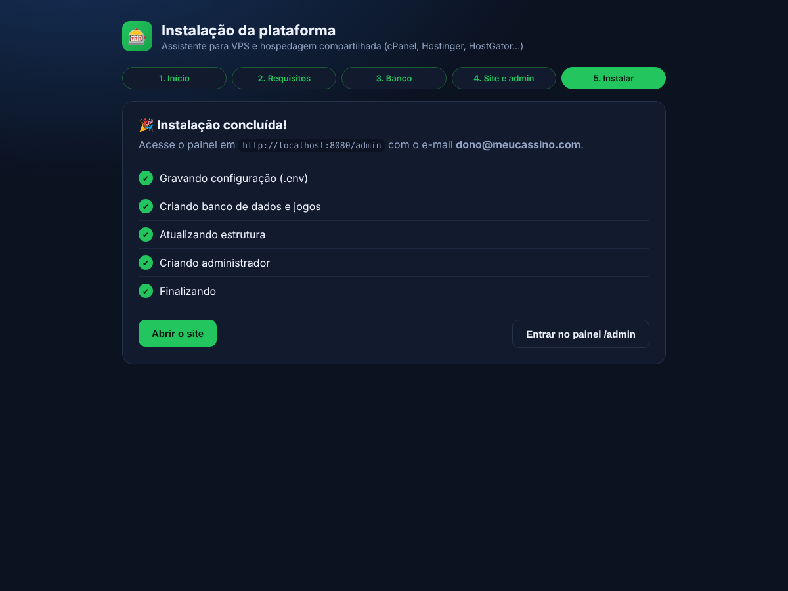
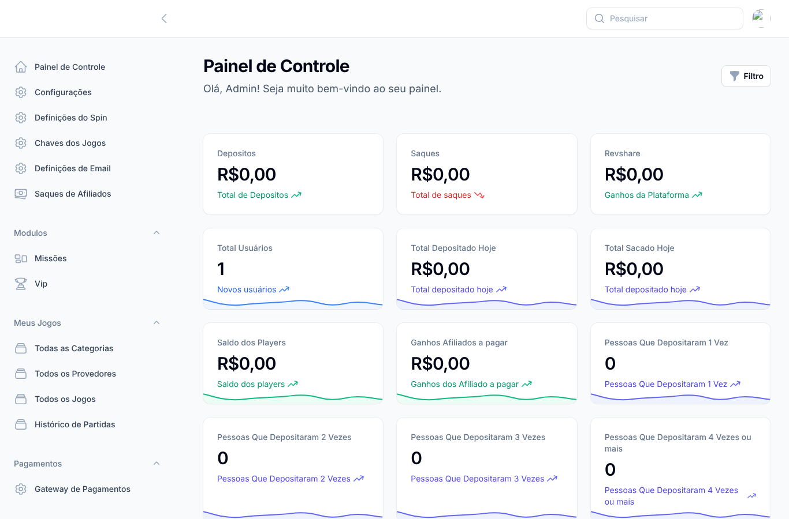

# 📦 Guia de instalação

Este guia cobre os cenários suportados:

| Cenário | Para quem | Tempo |
|---|---|---|
| [A. Hospedagem compartilhada](#a-hospedagem-compartilhada-cpanel-hostinger-hostgator) (cPanel, Hostinger, HostGator, Locaweb...) | Quem não tem acesso root/SSH | ~10 min |
| [B. VPS / servidor dedicado](#b-vps-ubuntu--debian--1-comando) (Ubuntu 22.04/24.04, Debian 12) | Melhor desempenho e controle | ~5 min (1 comando) |
| [C. Instalação manual](#c-instalação-manual-ssh--desenvolvimento) | Quem já tem PHP/Composer no servidor | ~5 min |
| [D. No seu computador (localhost)](#d-no-seu-computador-localhost) (Windows, macOS, Linux) | Testar, personalizar e desenvolver | ~5 min |

Em todos os casos a instalação é feita por um **assistente** que cria o banco de dados, o arquivo `.env` e o seu usuário administrador. Não é preciso importar SQL nem editar arquivos à mão.

Depois de instalar, veja o **[Manual de uso](MANUAL-DE-USO.md)** (painel, configurações, pagamentos, jogos).

> ⚖️ **Antes de começar:** operar apostas e jogos de azar exige licença na maior parte dos países (no Brasil, autorização da Secretaria de Prêmios e Apostas — Lei 14.790/2023). Você é responsável pelas licenças, KYC/PLD, jogo responsável, LGPD e pelo direito de uso dos jogos e provedores que ativar.

---

## Requisitos

| Item | Mínimo |
|---|---|
| PHP | 8.1, 8.2 ou 8.3 (recomendado 8.2/8.3) |
| Extensões PHP | `pdo_mysql`, `mbstring`, `openssl`, `tokenizer`, `xml`, `ctype`, `json`, `bcmath`, `fileinfo`, `curl`, `zip`, `intl`, `gd`, `dom` |
| Banco | MySQL 5.7+/8 ou MariaDB 10.4+ |
| Espaço | ~1,5 GB |
| Servidor web | Apache (com `.htaccess`/mod_rewrite) ou Nginx |

O assistente verifica tudo isso e mostra exatamente o que falta.

---

## A. Hospedagem compartilhada (cPanel, Hostinger, HostGator...)

### 1. Baixe o pacote pronto

Na página **[Releases](https://github.com/Edton180/casino/releases)** do repositório, baixe
**`casino-pronto-para-hospedagem.zip`**. Ele já vem com:

- as dependências PHP (pasta `vendor`) — você **não** precisa de SSH nem Composer;
- o frontend compilado (`public/build`) — você **não** precisa de Node.js.

> O pacote é gerado automaticamente pelo GitHub Actions a cada atualização do `main`.
> Se baixar o código-fonte (botão *Code → Download ZIP*), faltará a pasta `vendor` e o site mostrará uma página explicando isso.

### 2. Escolha a versão do PHP

No painel: **Selecionar versão do PHP** (cPanel) ou **Avançado → Configuração PHP** (Hostinger).
Escolha **PHP 8.2 ou 8.3** e marque as extensões: `intl`, `zip`, `gd`, `bcmath`, `fileinfo`, `pdo_mysql`, `mbstring`, `curl`.

### 3. Crie o banco de dados

cPanel → **Bancos de dados MySQL**:

1. Crie um banco (ex.: `usuario_casino`).
2. Crie um usuário com senha forte.
3. **Adicione o usuário ao banco** marcando **TODOS OS PRIVILÉGIOS**.

Anote: nome do banco, usuário e senha. O servidor quase sempre é `localhost`.

### 4. Envie os arquivos

Gerenciador de arquivos → abra a pasta **`public_html`** (ou a pasta do domínio/subdomínio) →
**Carregar** o zip → clique com o botão direito → **Extract/Extrair**.

A estrutura deve ficar assim:

```
public_html/
├── .htaccess        ← envia tudo para public/ e bloqueia arquivos internos
├── app/
├── public/
├── vendor/
└── ...
```

> **Dica:** se o painel permitir mudar o *Document Root* do domínio, aponte-o para `public_html/public`. É opcional — o `.htaccess` incluído já protege `.env`, `storage`, `vendor` etc.

### 5. Rode o assistente

Acesse **`https://seu-dominio.com/install/`** e siga as etapas:

1. **Início** — leia e aceite o aviso legal.
2. **Requisitos** — tudo deve ficar verde. Itens vermelhos mostram como corrigir.
3. **Banco** — informe host (`localhost`), porta (`3306`), nome, usuário e senha → **Testar conexão**.
4. **Site e admin** — nome do site, URL (use `https://` se o SSL já estiver ativo), seu e-mail e senha de administrador.
5. **Instalar** — aguarde as 5 etapas ficarem verdes.

| Requisitos | Concluído |
|---|---|
|  |  |

Pronto! O painel fica em **`https://seu-dominio.com/admin`**:



Por segurança o instalador é bloqueado depois de concluído (`storage/installed.lock`).

### 6. Ative o SSL e o cron

- **SSL:** cPanel → *SSL/TLS Status* → **Run AutoSSL** (gratuito). Depois edite o `.env` e troque `APP_URL=http://` por `https://`.
- **Cron** (bônus de cashback e tarefas agendadas): cPanel → **Cron Jobs** → *A cada minuto*:

  ```
  cd /home/SEU_USUARIO/public_html && php artisan schedule:run >> /dev/null 2>&1
  ```

  > Em algumas hospedagens o PHP do cron é `/usr/local/bin/php` ou `/opt/cpanel/ea-php83/root/usr/bin/php`.

Continue em [Depois de instalar](#depois-de-instalar).

---

## B. VPS (Ubuntu / Debian) — 1 comando

Aponte o DNS do domínio (registro **A**) para o IP do servidor e rode **como root**:

```bash
curl -fsSL https://raw.githubusercontent.com/Edton180/casino/main/scripts/auto-install.sh -o auto-install.sh
sudo bash auto-install.sh --domain meusite.com --email voce@meusite.com --ssl
```

O script:

1. instala **Nginx, PHP 8.3 (FPM), MariaDB, Composer** e o Certbot;
2. baixa o código em `/var/www/casino`;
3. cria o banco `casino` com **senha aleatória**;
4. executa o instalador da aplicação (`php artisan system:install`);
5. configura o **Nginx**, o **SSL** (Let's Encrypt) e o **cron**;
6. salva tudo em `/root/casino-credenciais.txt` (login do painel e senha do banco).

Opções úteis:

| Opção | Descrição |
|---|---|
| `--name "Meu Cassino"` | Nome do site |
| `--port 8080` | Porta HTTP, se a 80 já estiver em uso (sem SSL) |
| `--local` | Instala no próprio computador (`http://localhost`), sem domínio nem SSL — veja a seção D |
| `--admin-pass SENHA` | Senha do admin (padrão: gerada) |
| `--dir /var/www/outro` | Pasta da aplicação |
| `--php 8.2` | Versão do PHP |
| `-y` | Sem perguntas (automação) |
| `--update` | Atualiza uma instalação existente |
| `--diagnose` | Mostra o diagnóstico do servidor |

### Atualizar

```bash
sudo bash auto-install.sh --update
```

Baixa a versão nova, mantém `.env` e uploads, roda as migrations e limpa os caches.

### Backup

```bash
sudo bash /opt/casino-src/scripts/casino-backup   # banco + .env + uploads em /var/backups/casino (7 dias)
```

---

## C. Instalação manual (SSH / desenvolvimento)

```bash
git clone https://github.com/Edton180/casino.git
cd "casino/extraia para public_html/public_html"
composer install --no-dev --optimize-autoloader
php artisan system:install            # pergunta banco, URL e administrador
```

Sem perguntas:

```bash
php artisan system:install --no-interaction \
  --url=https://meusite.com --name="Meu Cassino" \
  --db-host=localhost --db-name=casino --db-user=casino --db-pass='SENHA' \
  --admin-email=voce@meusite.com --admin-pass='SENHA_ADMIN'
```

Verificar só os requisitos: `php artisan system:install --check`.

Se o banco informado não existir e o usuário tiver permissão, ele é criado automaticamente.

O frontend já vem compilado em `public/build`. Para alterar o Vue/Tailwind:
`npm ci && npm run build`.

---

## D. No seu computador (localhost)

Para testar a plataforma, criar seus temas ou desenvolver. Escolha **uma** das opções:

### D1. Linux, macOS ou Windows com WSL — 1 comando

Requer PHP 8.1+ (com as extensões da tabela de requisitos) e MySQL/MariaDB rodando.

```bash
git clone https://github.com/Edton180/casino.git
cd casino
bash scripts/install-local.sh --db-user root --db-pass SUA_SENHA_DO_MYSQL
```

O script baixa o Composer se precisar, **cria o banco `casino_local`**, instala e já abre o servidor:

| | |
|---|---|
| Site | http://127.0.0.1:8000 |
| Painel | http://127.0.0.1:8000/admin |
| Login | `admin@casino.local` / `admin12345` |

Para ligar o site de novo depois: `bash scripts/install-local.sh --serve`.
Opções: `--port`, `--db-host`, `--db-name`, `--admin-email`, `--admin-pass`, `--name`, `--no-serve` (veja `--help`).

> No Ubuntu o usuário `root` do MariaDB não aceita senha pela rede; crie um usuário próprio — veja [Solução de problemas](SOLUCAO-DE-PROBLEMAS.md#instalação-local-localhost).

### D2. Windows com XAMPP ou Laragon — duplo clique

1. Instale o [XAMPP](https://www.apachefriends.org) (PHP 8.2+) ou o [Laragon](https://laragon.org).
2. No XAMPP, abra `C:\xampp\php\php.ini` e tire o `;` da frente de `extension=intl`, `extension=zip` e `extension=gd`.
3. Inicie o **MySQL** no painel do XAMPP/Laragon.
4. Baixe o repositório (*Code → Download ZIP*) e extraia.
5. Dê dois cliques em **`scripts\install-local-windows.bat`** (no Laragon, rode pelo *Terminal* do Laragon).
6. O navegador abre em http://127.0.0.1:8000 — login `admin@casino.local` / `admin12345`.

Para abrir de novo depois, dê dois cliques no mesmo arquivo (ele pula a instalação).

### D3. Ubuntu/Debian com Nginx (igual a um servidor)

```bash
sudo bash scripts/auto-install.sh --local          # http://localhost
sudo bash scripts/auto-install.sh --local --port 8080   # se a porta 80 estiver ocupada
```

Instala Nginx, PHP-FPM, MariaDB e o cron, como na VPS, mas sem domínio e sem SSL.

### D4. Docker (qualquer sistema)

Com o [Docker Desktop](https://www.docker.com/products/docker-desktop/) instalado, na pasta do repositório:

```bash
docker compose up -d
```

A primeira subida leva alguns minutos. Depois: http://localhost:8000 (painel em `/admin`, login `admin@casino.local` / `admin12345` — altere no `docker-compose.yml` **antes** da primeira subida).
Parar: `docker compose down` · apagar tudo, inclusive o banco: `docker compose down -v`.

> ⚠️ Em instalações locais o login padrão é público. Nunca exponha essa instalação na internet sem trocar a senha.

---

## Depois de instalar

### 1. Pagamentos
Painel → **Pagamentos → Gateway de Pagamentos**. Informe as credenciais e ative:
Mercado Pago, PagSeguro, Pagar.me, Asaas, Stripe e PayPal.
Cadastre os webhooks no painel de cada gateway — detalhes em **[PAGAMENTOS.md](PAGAMENTOS.md)**.

### 2. Jogos
- Os **jogos originais** (Mines, Crash, Dice, Plinko, Double, Tower, HiLo, Wheel) e os jogos locais já funcionam sem nenhuma configuração.
- Para jogos de **provedores** (PlayFiver, Fivers, WorldSlot...): configure as chaves em **Configurações → Chaves dos Jogos** e ative os jogos em **Meus Jogos → Todos os Jogos** (selecione e use a ação em massa **Ativar Jogos**).
  Detalhes em **[JOGOS.md](JOGOS.md)**.

### 3. Aparência
- **Configurações** → nome, logos, banners, limites de depósito/saque, bônus e rollover.
- **Customização** → cores, CSS/JS, banners da home.

O passo a passo de cada tela está no **[Manual de uso](MANUAL-DE-USO.md)**.

### 4. E-mail (recuperação de senha e notificações)
**Definições de Email** no painel, ou no `.env`:

```env
MAIL_MAILER=smtp
MAIL_HOST=smtp.seuprovedor.com
MAIL_PORT=587
MAIL_USERNAME=usuario
MAIL_PASSWORD=senha
MAIL_ENCRYPTION=tls
MAIL_FROM_ADDRESS=nao-responda@meusite.com
```

### 5. Checklist de produção
- [ ] `APP_DEBUG=false` e `APP_ENV=production` no `.env` (o instalador já grava assim)
- [ ] HTTPS ativo e `APP_URL` com `https://`
- [ ] Cron rodando a cada minuto
- [ ] Webhooks dos gateways cadastrados
- [ ] Backup diário do banco
- [ ] Senha forte no administrador

Problemas? Veja **[SOLUCAO-DE-PROBLEMAS.md](SOLUCAO-DE-PROBLEMAS.md)**.

---

## Reinstalar do zero

1. Apague `storage/installed.lock` (gerenciador de arquivos ou SSH).
2. Acesse `/install/` e marque **Apagar dados existentes** na etapa do banco.

> ⚠️ Isso apaga **todos** os dados (usuários, saldos, histórico).
